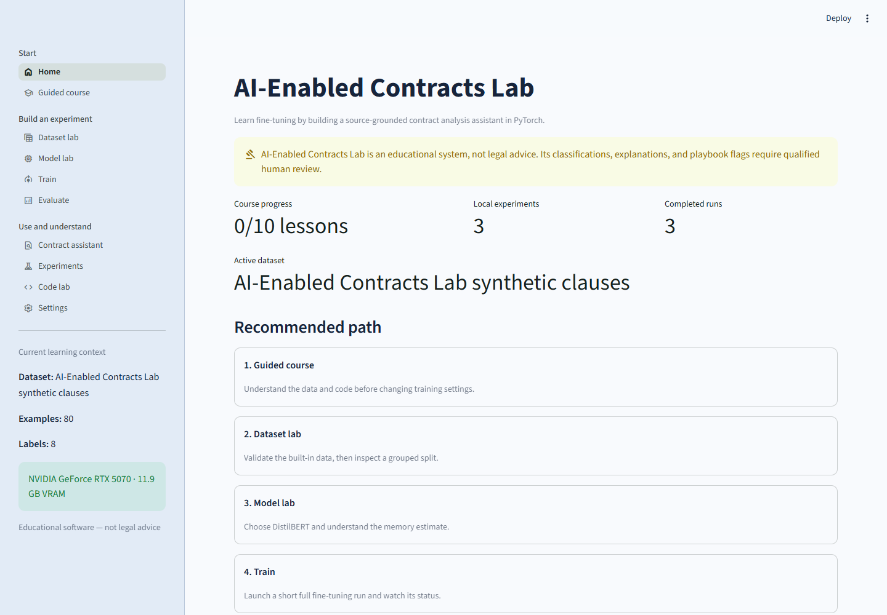
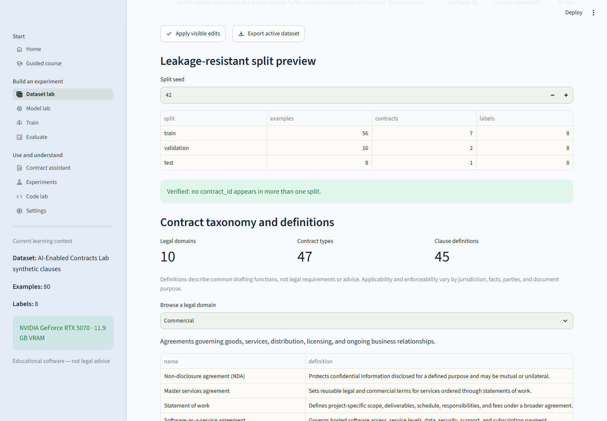
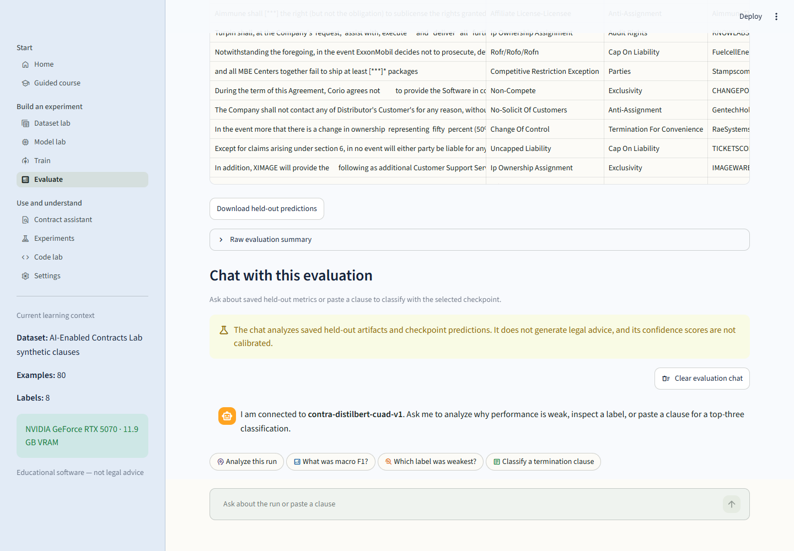
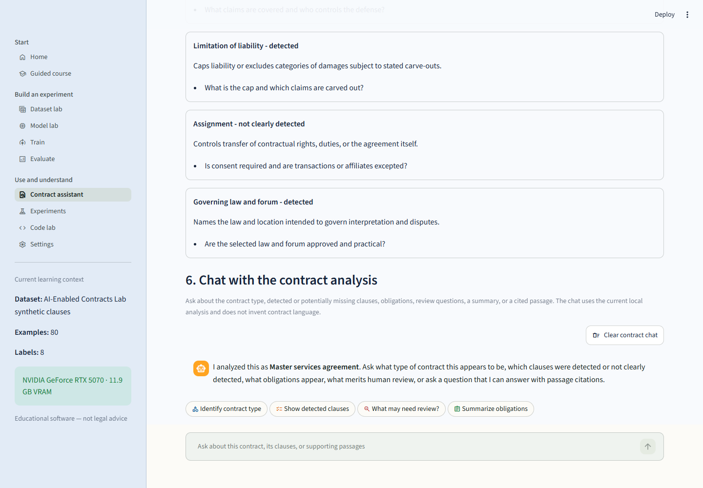
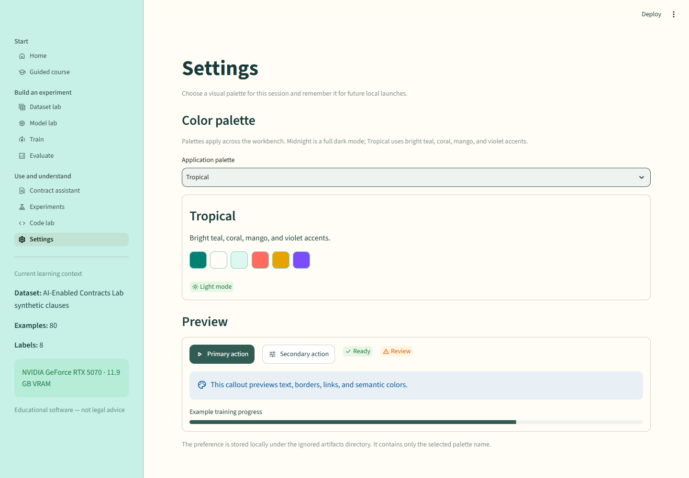
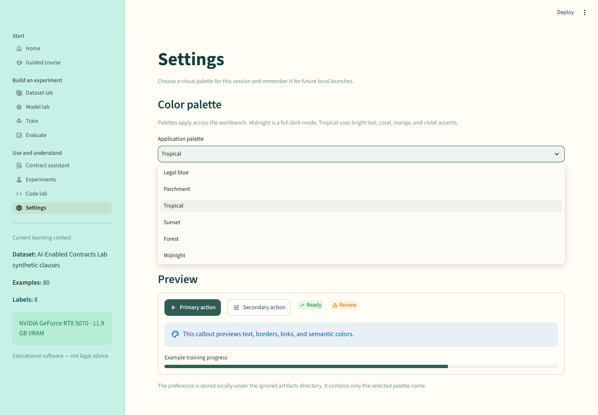
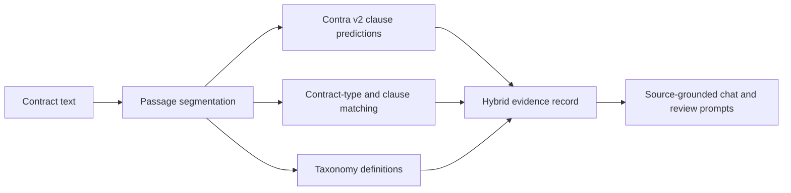

# AI-Enabled Contracts Lab

[](https://github.com/RamiJaloudi/ai-enabled-contracts-lab/actions/workflows/ci.yml)
[](https://www.python.org/)
[](https://streamlit.io/)
[](https://pytorch.org/)
[](LICENSE)
[](datasets/README.md)

**Build, evaluate, and understand a transparent hybrid legal-AI system.**
AI-Enabled Contracts Lab is a local, PyTorch-first Streamlit workbench that combines
fine-tuned BERT encoders for auditable legal routing with a generative LLM for bounded
analysis, contract drafting, and multi-turn chat. It exposes provenance, grouped splitting,
tokenization, training, evaluation, error analysis, jurisdiction routing, structured outputs,
code export, and experiment tracking.

This is a modern production-style architecture—not a claim of state-of-the-art benchmark
performance. Contra v2 reaches `0.6036` macro-F1 on this project's contract-grouped CUAD
derivative, with six of 41 labels at zero held-out F1. It is educational software, not legal
advice. Every model result and draft requires qualified human review.

## Project navigation

- **Use the app:** [Quick start](#quick-start-on-windows) · [Workbench map](#workbench-map) · [Contract Chat](#contract-chat)
- **Understand the system:** [Hybrid architecture](#modern-hybrid-architecture) · [Architecture document](docs/ARCHITECTURE.md) · [Evaluation](#contra-v2)
- **Publish safely:** [Private GitHub release](#private-first-publishing) · [Hugging Face guide](docs/HUGGING_FACE_RELEASE.md) · [Release checklist](docs/PUBLIC_RELEASE_CHECKLIST.md)
- **Read the full guide:** [Word guide](docs/AI_Enabled_Contracts_Lab_User_Guide.docx) · [Markdown source](docs/AI_Enabled_Contracts_Lab_User_Guide.md)
- **Model destination:** [rjaloudi/contra-contracts-bert-cuad-clause-classifier](https://huggingface.co/rjaloudi/contra-contracts-bert-cuad-clause-classifier)

## Modern hybrid architecture

```mermaid
flowchart LR
    A["Facts or contract"] --> B["Preprocess and segment"]
    B --> C["BERT domain classifier"]
    C --> D["BERT doctrine top-k"]
    D --> E["Independent issue spotting"]
    E --> F["Jurisdiction router"]
    F --> G["Prompts and legal skills"]
    G --> H["Local generative LLM"]
    H --> I["Structured analysis or complete draft"]
    I --> J["Evaluation and human review"]
```



The encoder produces hypotheses—not legal conclusions—and preserves top-k scores, model
version, taxonomy version, and routing confidence. The generative layer organizes issues,
elements, facts, counterarguments, missing facts, uncertainty, and drafts. It must not invent
cases, statutes, regulations, docket numbers, quotations, or citations. Because this release has
no RAG layer, unavailable jurisdiction-specific authority is explicitly marked
`JURISDICTION_SPECIFIC_VERIFICATION_REQUIRED`.

## Workbench preview

| Guided home | Dataset Lab and definitions |
|---|---|
|  |  |

| Evaluation analysis chat | Contract Assistant chat |
|---|---|
|  |  |

| Tropical palette | Midnight dark mode |
|---|---|
|  |  |

## What is included

- A complete ten-lesson course with linked source, activities, self-checks, deliverables, persistent progress, and downloadable notes.
- Complete attributed CUAD-derived classifier and instruction datasets.
- A public taxonomy with **10 domains, 47 contract types, and 45 clause definitions**.
- A handwritten PyTorch training loop with cross-entropy, class weighting, and focal loss.
- General, legal-domain, and contract-domain Hugging Face encoder presets.
- Optional Weights & Biases tracking that excludes clause text and filenames.
- Evaluation metrics, per-label analysis, confusion data, error review, and diagnostic chat.
- Contract Chat with multi-turn conversation, optional attachments, local storage, complete drafting, and DOCX/TXT export.
- Contract Assistant with contract-type detection, clause definitions, and cited passages.
- Script and Jupyter exports so the UI never hides the learning code.
- Six persistent palettes, including Tropical and Midnight dark mode.
- **Contra v2**, the included Contracts-BERT clause-classifier baseline.

## Quick start on Windows

Requirements: Windows, [uv](https://docs.astral.sh/uv/), and an NVIDIA driver for
the CUDA profile. Python 3.12 is selected automatically.

```powershell
git clone https://github.com/RamiJaloudi/ai-enabled-contracts-lab.git
Set-Location ai-enabled-contracts-lab
.\setup.ps1
.\run.ps1
```

You can also double-click `run-ai-enabled-contracts-lab.bat`. The URL is
<http://localhost:8501>.

Manual RTX 5070 commands:

```powershell
uv sync --python 3.12 --extra dev --extra cu129
uv run --extra cu129 streamlit run streamlit_app.py
```

CPU-only development or CI:

```powershell
uv sync --python 3.12 --extra dev --extra cpu
uv run --extra cpu streamlit run streamlit_app.py
```

Do not select `cpu` and `cu129` together; they are intentionally conflicting
PyTorch profiles.

## Contra v2

**Contra** is the short display name. The private-first Hugging Face repository is
[`rjaloudi/contra-contracts-bert-cuad-clause-classifier`](https://huggingface.co/rjaloudi/contra-contracts-bert-cuad-clause-classifier).

| Held-out result | Contra v1 | Contra v2 |
|---|---:|---:|
| Base model | DistilBERT | Contracts-BERT |
| Training loss | Cross-entropy | Class-weighted cross-entropy |
| Accuracy | 0.6062 | **0.7639** |
| Macro precision | 0.3445 | **0.6456** |
| Macro recall | 0.3394 | **0.6151** |
| Macro F1 | 0.2986 | **0.6036** |
| Zero-F1 labels | **20 of 41** | **6 of 41** |
| Held-out examples | 1,008 | 1,008 |

Both runs use the same deterministic CUAD derivative, seed, contract-grouped split,
and validation macro-F1 checkpoint rule. V2 uses
[`nlpaueb/bert-base-uncased-contracts`](https://huggingface.co/nlpaueb/bert-base-uncased-contracts),
a BERT-base model pre-trained on U.S. contracts, with clipped inverse-square-root
class weights.

V2 is a major improvement, but it is still an educational alpha. Six rare labels have
zero held-out F1, confidence is not calibrated, and the model only knows its 41 CUAD
labels. Its upstream model is CC BY-SA 4.0, so the v2 model bundle carries that license.
See the [model card](docs/models/CONTRA_MODEL_CARD.md) and
[Hugging Face release guide](docs/HUGGING_FACE_RELEASE.md).

## CUAD trained models and Transformers

The official CUAD project published extractive-QA checkpoints for RoBERTa-base
(about 100M parameters), RoBERTa-large (about 300M), and DeBERTa-v2-xlarge
(about 900M). Those models select answer spans in contract context; Contra
classifies already segmented passages. The tasks are complementary and must not
share a classifier head or metric table.

Hugging Face Transformers is already a required dependency of this project and
is used by both training and inference. CUAD's Python 3.8, PyTorch 1.7, and
Transformers 4.3/4.4 versions record its 2021 reproduction environment; this
project intentionally keeps its tested modern Python 3.12 / PyTorch / Transformers
stack. On 12 GB VRAM, RoBERTa-base is the sensible future span-extraction
experiment. The larger official checkpoints are not first-choice fine-tuning
targets for this hardware.

## Hybrid legal-analysis API

The repository also includes the first no-RAG vertical slice described in
[docs/BUILD_PLAN.md](docs/BUILD_PLAN.md): classifier candidates, prompt and skill routing,
explicit jurisdiction handling, a model-neutral generative interface, Pydantic validation, and
FastAPI endpoints.

Start the local API with:

    .\run-api.ps1

The service exposes POST /classify, POST /analyze, POST /analyze-document, POST /chat,
GET /health, and GET /models. `/classify` preserves separate domain and doctrine top-k
predictions, calibration provenance, margins, and an `AUTO_ROUTE`, `REVIEW_REQUIRED`, or
`ABSTAIN` decision. `/analyze-document` segments long documents into identified passages,
classifies them in batches, and supplies bounded evidence packets to the generative model.
Generative analysis uses the local Ollama provider configured in
[config/legal_ai.json](config/legal_ai.json). Classifier confidence remains separate from
analysis confidence, and unverified jurisdiction-specific law is marked
JURISDICTION_SPECIFIC_VERIFICATION_REQUIRED.

Set `CONTRACTLAB_API_KEY` to require the same value in the `x-contractlab-api-key` header.
The API is localhost-bound by `run-api.ps1`, enforces configurable request and concurrency
limits, treats uploaded text as untrusted data, and records reproducibility and safety metadata
in each analysis audit envelope.
## Why Contract Assistant is hybrid

A clause classifier recognizes labels passage by passage, but it cannot by itself identify
every contract type, define all provisions, or decide whether a whole document omits a common
category. The app therefore separates three inspectable layers:



When Contra is low-confidence or predicts outside the assistant's supported concepts,
the transparent playbook may override it. The UI says which engine was used. Chat cites
passage IDs, exposes definitions, distinguishes “not detected” from “legally absent,”
and does not fabricate existing contract language. A chat request for a complete agreement
uses a separate structured drafting path and returns both `.docx` and `.txt` artifacts. Missing
business terms remain bracketed placeholders, and every generated document is marked as a draft
for human and counsel review. Select **Draft complete contract** in the chat mode control to force
full-document output regardless of wording. If Ollama returns truncated or invalid structured
JSON, a source-preserving deterministic drafter still creates both complete editable artifacts.

## Datasets and definitions

The repository includes deterministic derivatives of
[CUAD v1](https://github.com/The-Atticus-Project/cuad), curated by The Atticus
Project and declared under CC BY 4.0.

| Dataset | Rows | Contracts | Purpose |
|---|---:|---:|---|
| `sample_200.jsonl` | 200 | 68 | Small instruction/chat sample |
| `cuad_classifier_sample.csv` | 75 | 68 | Fast classifier tutorial |
| `clauses.csv` | 6,702 | 510 | Full 41-label classifier fine-tuning |
| `train.jsonl/train.jsonl` | 14,491 | 408 | Instruction training split |
| `val.jsonl/val.jsonl` | 1,784 | 51 | Instruction validation split |
| `test.jsonl/test.jsonl` | 1,733 | 51 | Instruction test split |
| `contract_taxonomy.json` | 45 definitions | 47 types | Cross-domain definitions and typical-clause mappings |
| Local synthetic 396-label corpus | 39,600 | Template groups | Experimental vocabulary pretraining; raw data local-only |
| Local legal multidomain bundle | 560,000 | 28 domains | Contra-Law Experimental / 1,120 domain-qualified labels |

The local contract_clauses_all_39600.csv experiment adds all 396 synthetic
labels as a separate classifier task. Dataset Lab derives template groups and
creates a fresh split; it does not merge these labels into Contra's 41-label
head. The raw corpus is Git-ignored pending documented generation provenance
and redistribution rights. Its audit summary is public in
datasets/synthetic_396_audit.json, including the duplicate and template-leakage
measurements that prevent treating synthetic test scores as a legal benchmark.


Contra-Law Experimental is a separate one-epoch Legal-BERT classifier run over
all 560,000 synthetic multidomain examples. It uses 1,120 domain-qualified
labels so concepts reused across domains remain distinct. The source bundle and
classifier projection remain local-only. The public audit records severe
answer/template leakage, including target-label wording in every input, so this
run is a pipeline and taxonomy experiment rather than evidence of legal
reasoning or an upgrade to Contra's CUAD benchmark. Reproduce it with
configs/contra-law-legalbert-1120-exp-v1.json and
tools/prepare_legal_multidomain.py.


The 18,008 instruction examples span four tasks and have zero source-contract overlap.
`datasets/MANIFEST.json` records checksums and validation results. Large splits use Git LFS.

The taxonomy covers commercial, corporate, employment, family, real-estate, finance,
IP/technology, consumer, government, and healthcare agreements. It is non-exhaustive and
jurisdiction-neutral. Definitions describe common drafting functions, not legal requirements.

[ContractNLI](https://stanfordnlp.github.io/contract-nli/) is the recommended next NDA
training source: it has 607 NDAs, 17 fixed hypotheses, three-way entailment labels, and
evidence spans. It is not silently bundled because its publisher requires users to review
and accept its terms. The integration roadmap preserves that explicit acceptance step.

Read [datasets/README.md](datasets/README.md), [docs/DATASETS.md](docs/DATASETS.md), and
[NOTICE.md](NOTICE.md) before reuse. CUAD's publisher disclaims warranties about rights in
underlying SEC EDGAR contracts; users must evaluate rights for their own use.

## Workbench map

| Page | What you learn or do |
|---|---|
| Home | Understand the learning path and responsible-use boundary |
| Guided course | Follow ten lessons with explanations, math, and actual code |
| Dataset Lab | Inspect data, validate splits, and browse contract/clause definitions |
| Model Lab | Compare DistilBERT, DeBERTa, LEGAL-BERT, and Contracts-BERT |
| Train | Configure full fine-tuning and imbalance-aware loss |
| Evaluate | Analyze metrics and errors, then chat with saved run evidence |
| Contract Chat | Hold a multi-turn contract conversation, optionally attach files, and export complete drafts as DOCX or TXT |
| Contract Assistant | Identify contract type, inspect common clauses, and chat with citations |
| Experiments | Compare local runs and optional W&B context |
| Code Lab | Read source, export scripts/notebooks, and prepare reviewed private GitHub and Hugging Face releases |
| Settings | Select Legal Blue, Parchment, Tropical, Sunset, Forest, or Midnight |

## Manual commands

```powershell
# Environment report
uv run --extra cu129 contractlab doctor

# Rebuild public data metadata and definitions
.\.venv\Scripts\python.exe datasets\prepare_project_datasets.py --mode local
.\.venv\Scripts\python.exe datasets\build_manifest.py
.\.venv\Scripts\python.exe datasets\build_contract_taxonomy.py

# Prepare and repeat the local 560,000-example Contra-Law experiment
.\.venv\Scripts\python.exe tools\prepare_legal_multidomain.py
.\.venv\Scripts\python.exe -m contractlab.cli train --config configs\contra-law-legalbert-1120-exp-v1.json

# Train a saved configuration
uv run --extra cu129 contractlab train --config artifacts\configs\my-run.json

# Export an explained notebook
uv run --extra cu129 contractlab export-notebook --config artifacts\configs\my-run.json

# Prepare Contra v2 for reviewed Hugging Face upload
.\.venv\Scripts\python.exe tools\prepare_huggingface_model.py --version v2 --repo-id rjaloudi/contra-contracts-bert-cuad-clause-classifier

# Upload only after review and CLI authentication
.\.venv\Scripts\python.exe tools\prepare_huggingface_model.py --version v2 --repo-id rjaloudi/contra-contracts-bert-cuad-clause-classifier --push --private
```

For the complete walkthrough, open the
[Word user and developer guide](docs/AI_Enabled_Contracts_Lab_User_Guide.docx)
or its [Markdown source](docs/AI_Enabled_Contracts_Lab_User_Guide.md).

### Download and verify Contra v2

After the model repository has been uploaded and your Hugging Face account has access, authenticate
outside the app and run the project downloader:

```powershell
hf auth login
hf auth whoami
.\.venv\Scripts\python.exe tools\download_huggingface_model.py
```

The default destination is the Git-ignored `artifacts/models/contra-v2/` directory. The script
downloads only the seven reviewed release files, checks available disk space, validates the 41-label
mapping, and performs a local-only inference smoke test. Use a tag or full commit hash for a
reproducible download:

```powershell
.\.venv\Scripts\python.exe tools\download_huggingface_model.py `
  --revision FULL_COMMIT_HASH `
  --output artifacts\models\contra-v2
```

The official CLI can also download the repository directly, but it does not run the project's
bundle and inference checks:

```powershell
hf download rjaloudi/contra-contracts-bert-cuad-clause-classifier `
  --local-dir artifacts\models\contra-v2
```

Transformers can load the private repository through the credentials saved by `hf auth login`:

```python
from transformers import AutoModelForSequenceClassification, AutoTokenizer

repo_id = "rjaloudi/contra-contracts-bert-cuad-clause-classifier"
tokenizer = AutoTokenizer.from_pretrained(repo_id)
model = AutoModelForSequenceClassification.from_pretrained(repo_id)
```

To guarantee offline reuse after running the project downloader, load the validated local directory
with `local_files_only=True`. The official Hugging Face documentation covers
[`snapshot_download`](https://huggingface.co/docs/huggingface_hub/en/guides/download),
[`hf download`](https://huggingface.co/docs/huggingface_hub/en/guides/cli), and stored CLI
authentication. Do not put a Hub token in a command, script, notebook, Streamlit widget, or chat.

## Contract Chat

Contract Chat behaves as a continuing conversation. A user may ask a general contract question
without a document, paste text, or optionally attach supported files from the `+` control in the
chat composer. Messages and documents remain available across follow-up questions until **Clear
chat** is selected. The Local Workspace appears beneath the conversation for explicit document
management.

When asked for a complete or improved agreement, the drafting path returns the actual proposed
contract in the chat and provides matching `.docx` and `.txt` downloads. Unknown business terms
remain bracketed, supplied terms are preserved, and jurisdiction-dependent wording is flagged for
verification. Short review requests still return analysis instead of silently rewriting the whole
instrument.

## Private-first publishing

The intended GitHub repository is
[`RamiJaloudi/ai-enabled-contracts-lab`](https://github.com/RamiJaloudi/ai-enabled-contracts-lab).
The intended Contra v2 model repository is
[`rjaloudi/contra-contracts-bert-cuad-clause-classifier`](https://huggingface.co/rjaloudi/contra-contracts-bert-cuad-clause-classifier).
Create both as **private** staging repositories first.

```powershell
# GitHub: authenticate, inspect, test, commit reviewed files, then create privately
gh auth status
git status --short --ignored
uv run --extra cpu ruff check .
uv run --extra cpu pytest
uv build
gh repo create RamiJaloudi/ai-enabled-contracts-lab --private --source . --remote origin --push

# Hugging Face: authenticate in the official CLI and upload the prepared model privately
hf auth login
.\.venv\Scripts\python.exe tools\prepare_huggingface_model.py `
  --version v2 `
  --repo-id rjaloudi/contra-contracts-bert-cuad-clause-classifier `
  --push --private
```

Before either upload, inspect every staged or prepared file and scan for secrets, contracts,
private chat data, local model artifacts, and user paths. After upload, verify the rendered private
pages and perform a clean clone/download. Visibility should change only as a separate decision
after independent review. See the [GitHub release checklist](docs/PUBLIC_RELEASE_CHECKLIST.md),
[Hugging Face release guide](docs/HUGGING_FACE_RELEASE.md), and the full
[Word user and developer guide](docs/AI_Enabled_Contracts_Lab_User_Guide.docx).
## Quality checks

```powershell
uv lock --check
uv run --extra cpu ruff check .
uv run --extra cpu pytest
uv build
```

## Privacy and responsible use

- Imported documents and local run artifacts remain on the computer by default.
- W&B is opt-in and logs aggregate configuration and metrics, not clause text.
- Secrets belong in environment variables or ignored secret files.
- Do not commit private contracts, checkpoints, predictions, or credentials.
- A model score, missing-clause flag, or playbook prompt is not a legal conclusion.

See [docs/PRIVACY.md](docs/PRIVACY.md), [SECURITY.md](SECURITY.md), and
[docs/PUBLIC_RELEASE_CHECKLIST.md](docs/PUBLIC_RELEASE_CHECKLIST.md).

## Licenses and attribution

- Original source code and synthetic examples: [MIT](LICENSE).
- CUAD-derived datasets: [CC BY 4.0](datasets/LICENSE-CUAD-CC-BY-4.0.txt).
- Project-authored taxonomy: [CC BY 4.0](datasets/LICENSE-CONTRACT-TAXONOMY-CC-BY-4.0.txt).
- Contra v2 model bundle: CC BY-SA 4.0, following the upstream Contracts-BERT model.
- Third-party dependencies and models retain their own terms.

Contributions are welcome; start with [CONTRIBUTING.md](CONTRIBUTING.md) and
[CITATION.cff](CITATION.cff).
