# AI-Enabled Contracts Lab architecture

AI-Enabled Contracts Lab is a local-first, no-RAG legal AI workbench. It uses a modern hybrid pattern: discriminative Transformer encoders create auditable routing hypotheses, while a separate generative LLM performs bounded explanation, analysis, and drafting. This is a production-style engineering architecture, not a claim that the included model sets a state-of-the-art legal benchmark.

## System map

```mermaid
flowchart LR
    A["Facts or contract"] --> B["Preprocess and segment"]
    B --> C["BERT domain classifier"]
    C --> D["BERT doctrine top-k"]
    D --> E["Independent issue spotting"]
    E --> F["Jurisdiction router"]
    F --> G["Prompt and skill router"]
    G --> H["Local generative LLM"]
    H --> I["Structured analysis or contract draft"]
    I --> J["Evaluation, audit envelope, and human review"]
```



The encoder and generative layers have deliberately different responsibilities.

| Layer | Responsibilities | Must not do |
|---|---|---|
| BERT encoders | Domain classification, doctrine candidates, top-k scores, reranking, optional extraction | Long-form legal reasoning or final legal conclusions |
| Router | Abstention, issue reconciliation, jurisdiction selection, prompt/skill selection | Treat low confidence as certainty or silently assume a jurisdiction |
| Generative LLM | Explain issues, organize elements, apply facts, identify missing facts, generate counterarguments, summarize, and draft | Invent authority, claim verified jurisdiction-specific law without a source, or hide uncertainty |
| Human reviewer | Verify facts, governing law, citations, risk allocations, and final wording | Delegate professional responsibility to a model score |

## Repository structure

```text
streamlit_app.py
  -> app_pages/*                         Streamlit workbench pages
  -> contractlab/ui.py                   shared presentation and session helpers

app_pages/*
  -> contractlab/data.py                 validation, import, grouped splits
  -> contractlab/modeling.py             encoder presets and memory estimates
  -> contractlab/jobs.py                 background training processes
  -> contractlab/training.py             handwritten PyTorch training loop
  -> contractlab/evaluation.py           metrics and error analysis
  -> contractlab/inference.py            checkpoint loading and predictions
  -> contractlab/assistant.py            evidence-grounded contract demonstrations
  -> contractlab/contract_chat_store.py  local conversations, files, and exports
  -> contractlab/codegen.py              scripts and notebook exports

legal_ai/ and contractlab/legal_ai/
  -> classifiers                         domain and doctrine top-k adapters
  -> jurisdiction routing                federal, state, New Jersey, administrative, international
  -> prompts and skills                  bounded analysis instructions
  -> generative provider                 local Ollama-compatible interface
  -> schemas                             Pydantic request, result, and audit records

contractlab/cli.py
  -> the same reusable training modules without Streamlit
```

## Runtime flow

1. Dataset Lab validates records, provenance, and leakage-resistant grouped splits.
2. Train saves a versioned configuration and launches the reusable training pipeline.
3. The trainer tokenizes text, creates PyTorch data loaders, and fine-tunes an encoder.
4. Metrics, checkpoints, predictions, logs, and provenance are saved below `artifacts/runs/`.
5. Evaluate reports aggregate and per-label behavior, including rare and zero-F1 labels.
6. Contract Chat maintains a multi-turn local conversation, accepts optional files, and can export complete drafts as DOCX and TXT.
7. The API applies input checks, classifier routing, independent issue spotting, jurisdiction routing, legal prompts/skills, structured generation, semantic policy, and an audit envelope.

## Routing and abstention

Classifier predictions are hypotheses. Every routing result preserves top-k predictions, confidence scores, model version, taxonomy version, thresholds, and an `AUTO_ROUTE`, `REVIEW_REQUIRED`, or `ABSTAIN` decision. An abstention prevents a weak classifier from silently selecting the legal path; it does not suppress independent issue spotting.

Classifier confidence and legal-analysis confidence remain separate. The application never converts a softmax score directly into a statement that a claim succeeds or a clause is enforceable.

## Structured legal-analysis contract

For each materially plausible issue, the generative result is designed to keep these fields distinct:

1. Issue.
2. Rule or elements.
3. Supporting facts.
4. Adverse facts.
5. Missing facts.
6. Application.
7. Counterarguments or defenses.
8. Jurisdiction caveat.
9. Bounded conclusion.
10. Confidence and uncertainty.

Jurisdiction-specific authority that is not available through an authoritative source is marked `JURISDICTION_SPECIFIC_VERIFICATION_REQUIRED`. The current system intentionally has no retrieval-augmented generation layer.

## Contract drafting path

Complete drafting uses a dedicated schema rather than the shorter review response. Contract Chat returns the same proposed agreement as readable chat text and as privacy-scrubbed Word and plain-text files. Supplied terms are preserved, unknown business terms remain bracketed, assumptions and negotiation choices remain visible, and the result is labeled for human and counsel review.

## Trust boundaries

- Uploaded contracts, archives, and custom datasets are untrusted input.
- Local chat workspaces can contain confidential material and are excluded from Git.
- Model downloads, W&B, GitHub, and Hugging Face are explicit network boundaries.
- Access tokens remain in official credential stores or environment variables, never app fields or source files.
- `artifacts/`, `data/imports/`, `data/curated/`, secrets, W&B files, and model weights are Git-ignored.
- Synthetic legal data is training and evaluation scaffolding, not authoritative law.

## Evaluation philosophy

Accuracy is insufficient for imbalanced clause classification. The project reports macro precision, macro recall, macro-F1, per-label metrics, zero-F1 labels, confusion patterns, split provenance, and held-out sample counts. Contra v2 reaches `0.6036` macro-F1 on this project's 1,008-example contract-grouped CUAD derivative; six of 41 labels have zero held-out F1. Those limitations remain visible on the Home page, README, guide, and Hugging Face model card.

## Extension boundary

The architecture keeps classifier adapters, prompts, skills, schemas, LLM providers, and evaluation separate so a verified retrieval layer can be added later without redesigning the application. RAG is deliberately out of scope until its sources, authority provenance, jurisdiction behavior, and evaluation protocol are specified.